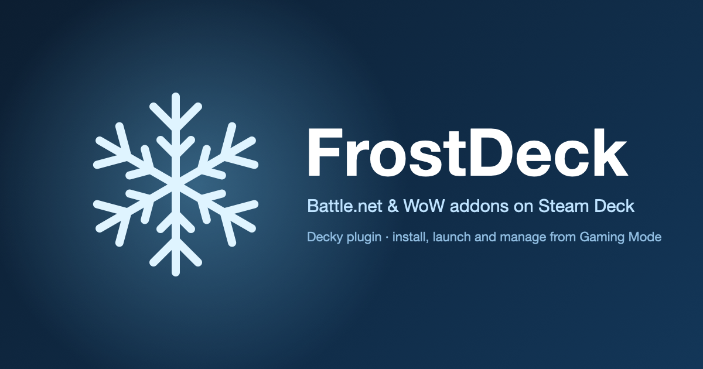
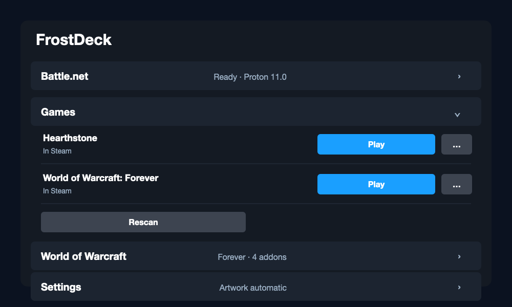
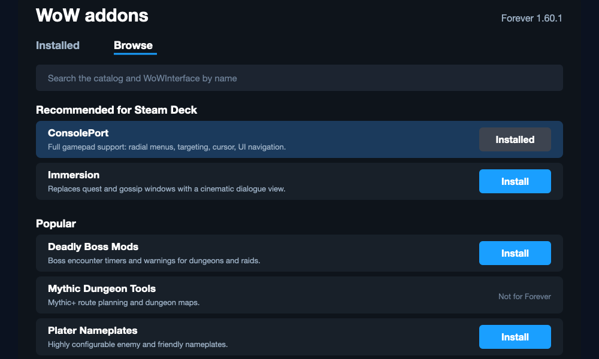
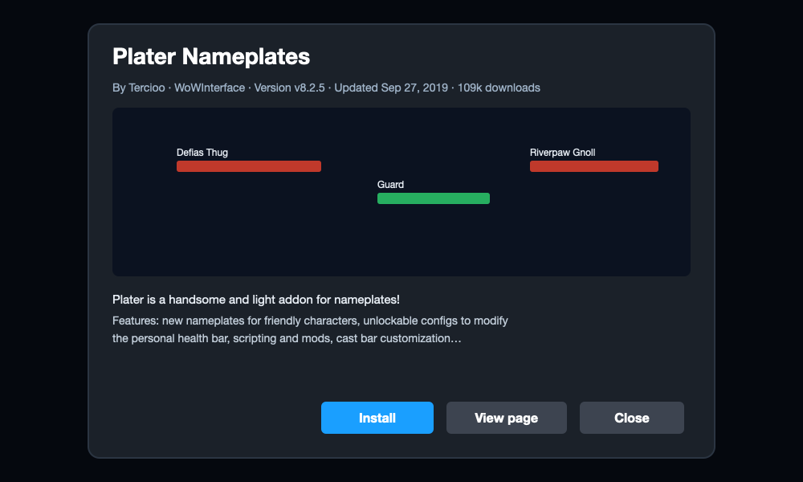

<div align="center">


[](https://github.com/cconroy11/FrostDeck/releases)
[](LICENSE)
[](https://decky.xyz)

</div>

<h1 align="center">FrostDeck</h1>

<p align="center">Battle.net and World of Warcraft addons on the Steam Deck, without leaving Gaming Mode.</p>

<p align="center">
  
</p>
<p align="center"><sub>The Quick Access panel, the addon browser, and an addon's details sheet (illustrations of the interface).</sub></p>

## What it does

Getting Battle.net onto a Deck used to mean Desktop Mode, a tutorial, and a lot of trackpad. FrostDeck does the whole thing from the Quick Access menu.

- **Battle.net in one tap.** Downloads Blizzard's official installer, runs it under Proton, adds a *Battle.net* shortcut to a *Blizzard* collection in your library, and opens it so you can sign in.
- **Games launch from Steam.** Every game you install inside Battle.net is detected and added as its own shortcut. Press Play and the game starts, with Steam Input, the overlay, and suspend and resume all working because Steam owns the process.
- **Artwork included.** Capsule, hero, logo, header and icon are applied automatically from SteamGridDB, with Valve's own art as a fallback for titles also sold on Steam.
- **WoW addons from the couch.** Detects each installed flavour (Retail, Classic, Classic Era, Forever), installs and updates addons from GitHub, WoWInterface and Tukui, and puts [ConsolePort](https://github.com/seblindfors/ConsolePort) controller support one tap away.
- **Clean removal.** Uninstall a game, remove just its shortcut, or reset everything. Uninstalling the plugin leaves your games and shortcuts intact.

## Installation

FrostDeck is not in the Decky store yet. Until it is:

1. Install [Decky Loader](https://wiki.deckbrew.xyz/en/user-guide/install) if you haven't.
2. Download `FrostDeck.zip` from the [latest release](https://github.com/cconroy11/FrostDeck/releases/latest).
3. On the Deck, open the Quick Access menu → Decky → Settings (gear) → General → enable **Developer Mode**. A Developer tab appears; in it choose **Install Plugin from ZIP** and pick the file.
4. Open the Quick Access menu again; FrostDeck is in the plugin list.

You need a Battle.net account. A free [SteamGridDB API key](https://www.steamgriddb.com/profile/preferences/api) is optional and turns on automatic artwork.

## Usage

**First run.** Open FrostDeck and press **Install Battle.net**. A progress bar runs while the installer downloads, then Steam launches it. Walk through the installer and sign in, ticking *Keep me logged in*. Come back to the panel and it reads *Ready*.

**Installing games.** Install games inside Battle.net as you would on Windows. Back in FrostDeck, the **Games** section lists them; press **Add to Steam** on each, or **Add all**. Each game appears in the *Blizzard* collection and launches directly.

**World of Warcraft.** Once WoW is installed, a **World of Warcraft** section shows each flavour with its addon count. **Addons** opens the manager:

- *Installed* shows what's in that flavour's AddOns folder, with Update buttons where a newer version exists and **Update all** at the top. Addons you copied in by hand are listed too, and known ones can be managed from here.
- *Browse* has a search box across the catalog and WoWInterface, with **Recommended for Steam Deck** and **Popular** beneath it. Press a name for details, screenshots and recent changes; press **Install** to install.
- Addons on GitHub that aren't listed can be added by repo name with **Add repo**.

**Settings.** Proton build (shared by every shortcut, pinned so Battle.net stays stable), artwork key, repair, and reset.

## Good to know

- **Quit games from inside the game.** Blizzard games save settings on a clean exit. Steam's *Exit Game* ends the process immediately and WoW loses what it hadn't written.
- **One Proton build for everything.** Switching builds mid-stream is the most common way Battle.net installs break. Change it from FrostDeck's dropdown so all shortcuts move together, and switch back if Battle.net complains.
- **Call of Duty titles don't run.** Their anti-cheat has no Linux support. Cloud streaming or a Windows install are the alternatives.
- **CurseForge-only addons aren't available**, including Retail WeakAuras. Sources are limited to ones with deterministic packages and no author opt-outs. See [Addon sources](#addon-sources).

## How it works

Steam runs Battle.net, not the plugin. FrostDeck creates non-Steam shortcuts, assigns a Proton build, and points every game at the same prefix, so there is one login and one install. Launching a game is a two-step dance: the current Battle.net client ignores `--exec="launch <game>"` on a cold start but honours it when a second copy forwards it over IPC once the client is up, so a small helper does exactly that inside the Steam session. Battle.net's own logs tell the plugin which games are installed and where.

Addons are plain folders under `<flavour>/Interface/AddOns`. FrostDeck reads the client's `.build.info` for each flavour's version and checks every package's `.toc` interface versions before replacing anything, so a Classic-only package is refused for Retail with a plain message.

### Addon sources

| Source | Needs a key | Coverage |
| --- | --- | --- |
| GitHub releases (BigWigs packager manifests) | No | Most major addons: ConsolePort, DBM, BigWigs, Plater, Bartender4, … |
| WoWInterface | No | About 8,000 addons, searchable |
| Tukui | No | ElvUI |
| CurseForge | Not supported yet | Long tail; many authors opt out of third-party clients |

## Troubleshooting

- **Logs:** `/home/deck/homebrew/logs/FrostDeck/` on the Deck, plus `~/.local/share/FrostDeck/bnet-launch.log` for the last game launch. Battle.net's own logs are inside the prefix under `drive_c/users/steamuser/AppData/Local/Battle.net/Logs/`.
- **A game opens Battle.net but doesn't start:** check the helper log; if Battle.net never reports *LaunchBinary*, open the game once from inside Battle.net, then try again.
- **Battle.net misbehaves after a Proton change:** switch back to the previous build in Settings.
- **Shortcuts stopped working after an update:** Settings → **Repair shortcuts** rewrites them from current state.

## Building

Node 18+ and pnpm 9.

```sh
pnpm i
pnpm run build        # bundles src/ into dist/index.js
pnpm run typecheck
DECK_HOST=deck@<deck-ip> ./deploy.sh   # build, copy to the Deck over SSH, restart Decky
```

`deploy.sh` stops Decky while it swaps files and verifies the copy, because Decky takes ownership of the plugins folder as root whenever it starts.

## Credits

- [Decky Loader](https://github.com/SteamDeckHomebrew/decky-loader) and the Steam Deck Homebrew community.
- [NonSteamLaunchers](https://github.com/moraroy/NonSteamLaunchers-On-Steam-Deck) and [Lutris](https://lutris.net), whose Battle.net scripts documented the launch codes and config layout.
- [ConsolePort](https://github.com/seblindfors/ConsolePort) by seblindfors, which makes WoW playable on a controller at all.
- [SteamGridDB](https://www.steamgriddb.com), [WoWInterface](https://www.wowinterface.com) and [Tukui](https://tukui.org) for their APIs.
- The [BigWigs packager](https://github.com/BigWigsMods/packager), whose release manifests make deterministic addon installs possible.

FrostDeck is an independent project and is not affiliated with or endorsed by Blizzard Entertainment or Valve. Battle.net, World of Warcraft and Steam Deck are trademarks of their respective owners.

## License

BSD 3-Clause. See [LICENSE](LICENSE).
